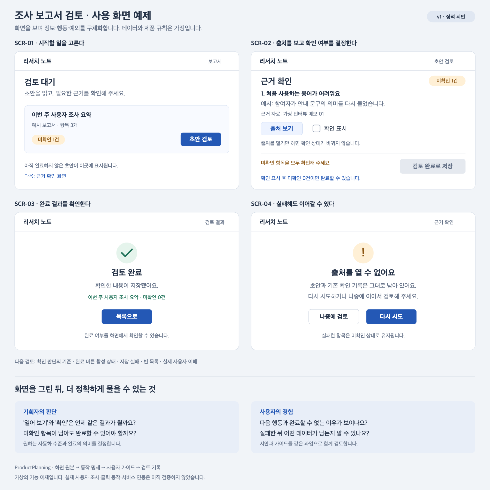

# ProductPlanning

기획자와 코딩 에이전트가 **실제 사용 화면을 그려 보며** 소프트웨어 제품을 구체화하는 작업 방법과 자료를 모은다. 기본 언어는 한국어다.

기획 보고서, 사용자 관점의 UI/UX 시안, 사용자 가이드를 먼저 발전시키고 핵심 경험과 남은 위험을 확인한 뒤 실제 제품 구현으로 넘어간다. 화면은 기획자·개발자·사용자가 함께 판단할 수 있는 공통 자료로 사용한다.

## 시작하기

1. [작업 흐름](docs/workflow.md)에서 현재 단계를 고른다.
2. [기획 인터뷰](.agents/skills/visual-product-planning/references/interview.md)로 의도와 판단 기준을 구체화한다.
3. [화면 예제](examples/report-review/README.md)를 참고해 첫 사용자 과업을 그림으로 만든다.
4. 화면을 보며 [기획서](.agents/skills/visual-product-planning/assets/templates/planning-brief.md), [화면 명세](.agents/skills/visual-product-planning/assets/templates/screen-spec.md), [사용자 가이드](.agents/skills/visual-product-planning/assets/templates/user-guide.md)를 함께 고친다.
5. [검토와 구현 전환 양식](.agents/skills/visual-product-planning/assets/templates/review-and-handoff.md)으로 다음 행동을 정한다.

## 화면으로 보는 예제

가상의 ‘조사 보고서 검토’ 기능이다. 목록, 근거 확인, 완료, 실패 복구를 실제 화면 형태로 표현했다. 데이터와 제품 규칙은 설명용 가정이다.

[편집 가능한 화면 원본](examples/report-review/screens-v1.svg) · [화면과 동작 명세](examples/report-review/screen-spec.md) · [사용자 가이드](examples/report-review/user-guide.md)

## 자료와 도구

| 목적 | 읽을 자료 |
|---|---|
| 원저자와 실무자의 방법론 | [기획 방법론과 출처 조사](docs/research/2026-11-08-methods.md) |
| 공개 스킬과 화면 제작 도구 비교 | [도구 선택과 도입 판단](docs/tools.md) |
| 의도와 암묵적인 판단을 알아내는 질문 | [인터뷰 지침](.agents/skills/visual-product-planning/references/interview.md) |
| 화면 제작과 검토 | [화면 검토 지침](.agents/skills/visual-product-planning/references/screen-loop.md) |
| 합의한 원칙과 적용 제안 | [기획 원칙과 결정](docs/decisions.md) |
| 확인한 범위와 남은 검증 | [검증 기록](docs/validation.md) |

## 코딩 에이전트에서 사용하기

[visual-product-planning](.agents/skills/visual-product-planning/SKILL.md)은 인터뷰 → 화면 → 기획·가이드 → 검토를 연결하는 저장소 내 스킬이다. 이 저장소를 지원하는 에이전트에서 열고 다음처럼 요청한다.

> `$visual-product-planning`으로 이 아이디어를 구체화해 줘. 먼저 내 의도를 확인하고 첫 사용 화면을 보여 줘. 화면을 보며 기획서와 사용자 가이드를 함께 발전시키자.

다른 프로젝트에서는 스킬 폴더 전체를 해당 프로젝트의 `.agents/skills/`로 복사해 사용할 수 있다. 자동 발견 여부는 사용하는 에이전트에서 확인한다. 전역 설치나 외부 도구 설치는 별도 선택이다.

## 운영 범위

이 저장소는 기획 방법, 스킬, 양식과 설명용 화면을 관리한다. 실제 제품 구현은 각 제품 작업공간에서 진행한다. 참고 자료는 요약과 직접 출처로 남기며 외부 스킬 전문이나 유료 도서를 복제하지 않는다.

초기 자료 확인일: **2026-11-08**. 도구별 기능과 명령은 사용할 때 현재 문서를 다시 확인한다.
