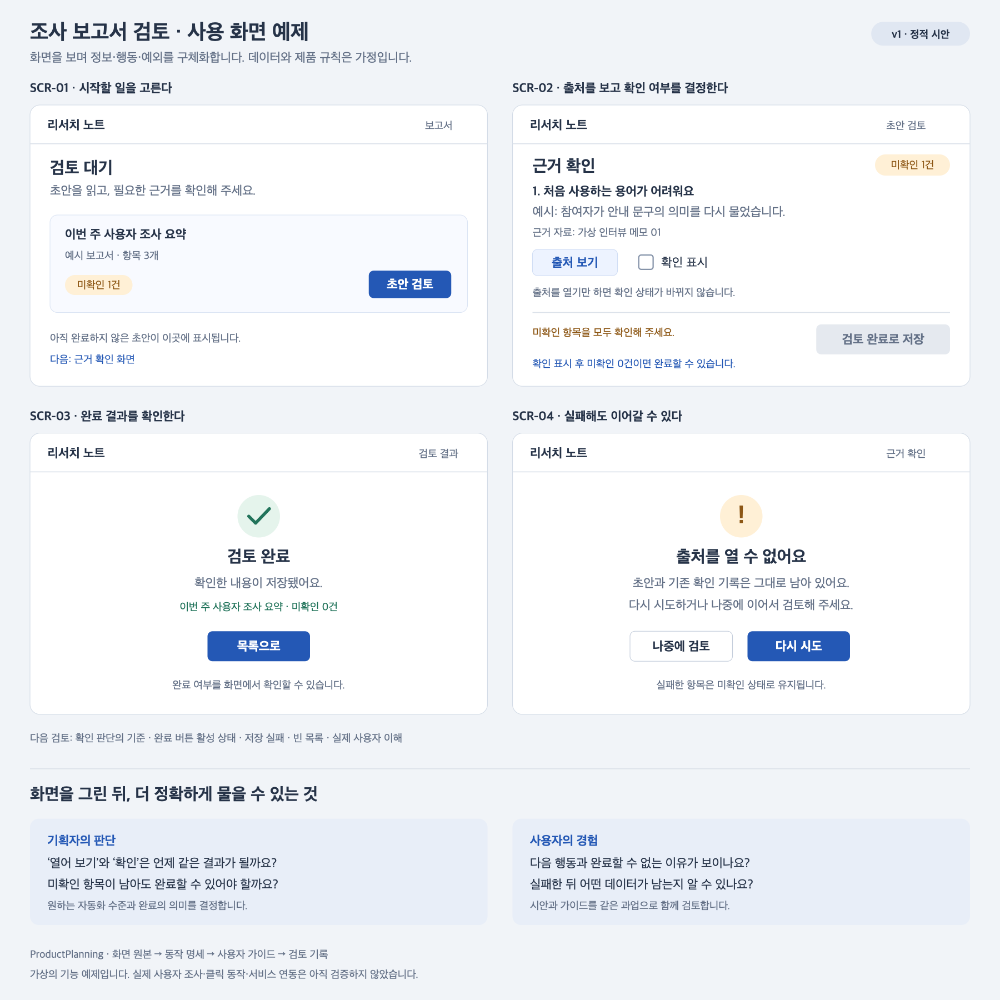

# 조사 보고서 검토 화면 예제

가상의 기능으로 화면·규칙·가이드를 연결하는 방법을 보여 준다. 데이터와 규칙은 설명용 가정이다. 실제 사용자 조사 결과나 제품 도입 결정이 아니다.

## 목표와 가정

사용자는 자동 생성된 조사 초안을 읽고 근거를 확인한 뒤 검토 완료로 저장한다. **미확인 항목이 남으면 완료로 바꾸지 않는다**는 규칙을 가정했다. 실제 제품에서의 채택 여부는 기획 인터뷰로 결정해야 한다.

[편집 가능한 SVG](screens-v1.svg) · [화면과 동작 명세](screen-spec.md) · [사용자 가이드](user-guide.md)

2026-11-14 보강한 기준을 적용한 [화면 자체 평가](quality-review.md)와 [사용자 테스트 계획](usability-plan.md)을 함께 볼 수 있다. v1의 미정 사항을 남겨 두어 평가 기준이 이를 어떻게 드러내는지 보여 준다.

## 화면을 보며 묻는 질문

1. ‘근거를 확인했다’는 판단은 출처를 여는 것과 어떻게 다른가?
2. 미확인 항목이 있어도 임시 저장하거나 공유할 수 있어야 하는가?
3. 출처를 열지 못했을 때 어떤 대안이 필요한가?

현재 예제는 출처 열기와 확인 표시를 별도 행동으로 두며 미확인 0건일 때 완료를 허용한다. 임시 저장·공유·검토자 간 충돌은 미정 범위다.

## 상태

v1 정적 화면이다. 렌더링과 문구·상태·가이드 대응을 자체 검토한다. 클릭 동작·실제 사용자 관찰·출처 연동은 미검증이며 구현 착수 상태가 아니다. 실제 점검 결과는 [검증 기록](../../docs/validation.md)에 남긴다.
