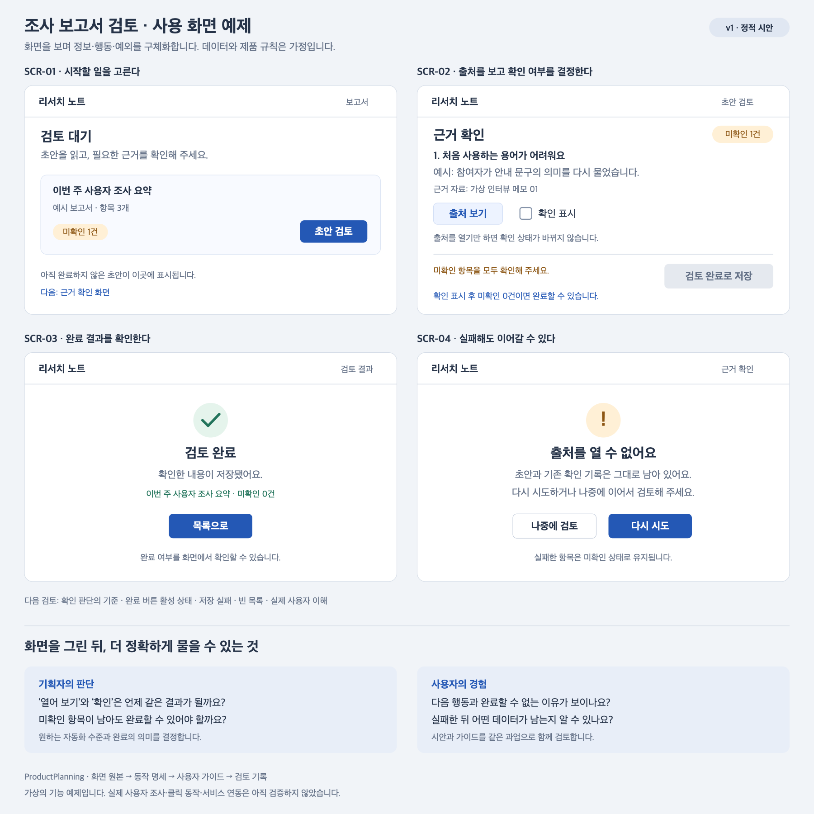

# 보고서 검토 시안의 화면 품질 평가

확인일: 2026-11-14. [화면 품질 지침](../../.agents/skills/visual-product-planning/references/screen-quality.md)을 v1에 적용한 **작성자의 자체 평가**다. 실제 사용자를 관찰한 결과가 아니다.

## 대상과 증거

- 과업: TASK-01, 초안을 읽고 근거를 확인한 뒤 검토 완료로 남기기.
- 대상: [정적 화면 v1](screens-v1.png), [SVG 원본](screens-v1.svg), [명세](screen-spec.md), [가이드](user-guide.md).
- 방법: 현재 SVG를 1800 × 1800 PNG로 다시 렌더링해 열람하고 문서와 대조했다. 서비스·DOM·입력 장치는 시험하지 않았다.
- SVG SHA-256: `d4faf237bfd226362af50901c316e4897dd5c46f91bab744e68464447cf4f811`.
- 이번 열람 PNG SHA-256: `c0a283e30df2f6b43d0c5075ddaeab574f443c102f2896d80e4d3aeea7771e43`.

## 확인한 강점

SCR-02에는 완료할 수 없는 이유가 텍스트로 보인다. 출처 열기와 확인 표시를 별도 행동으로 표현했다. SCR-04에는 기록 유지 안내와 재시도·중단 후 재개 경로가 보인다. 이는 표현의 확인이며 실제 동작의 검증은 아니다.

## 문제와 다음 확인

| ID·위치 | 사실과 근거 수준 | 영향·심각도 | 조치 제안 | 재검증 |
|---|---|---|---|---|
| Q-01 / SCR-02·명세 | ‘확인 표시’의 판단 기준이 명세에 미정으로 남아 있다. 정적·문서 점검. | 완료의 의미가 달라질 위험. 중요. | 기획자가 어떤 판단을 확인으로 볼지 정하고 문구·규칙·가이드에 반영한다. | 열린 후속 질문으로 사용자 해석을 확인하고 정상·경계 사례를 대조한다. |
| Q-02 / TASK-01 | 완료 버튼 활성 상태·완료 목록·저장 실패 모습이 없다. 명세도 이 범위를 남겨 두었다. | 시안만으로 핵심 과업 전체의 상호작용을 시험하기 어렵다. 중요. | 다음 시안에 상태를 추가하고 저장·실패·재개를 연결한다. | T-01의 완료 조건과 오류 복구를 클릭 또는 정해진 화면 교체 방식으로 확인한다. |
| Q-03 / SCR-04 | 어떤 항목의 출처가 실패했는지 식별하는 문구가 보이지 않는다. 정적 점검. | 여러 항목을 검토할 때 문맥을 잃을 가능성. 중요로 우선 검토하는 가설. | 실패 항목의 제목 또는 출처를 연결해 표시하는 안을 검토한다. | 여러 항목 중 실패한 항목과 다음 행동을 이해하는지 관찰한다. |

Q-03의 발생 빈도나 실제 실패율은 알 수 없다. 제안은 아직 사용자 결정이나 반영된 변경이 아니다.

## 접근성 확인 범위

원본 sRGB 색의 상대 휘도로 계산한 제한적인 증거다. 아래 수치는 표시용으로 줄였으며 경계값을 반올림해 통과시키지 않았다.

| 조합 | 대비 | 해석 |
|---|---|---|
| 흰 글자 / 주 행동 `#2458b5` | 6.691857:1 | 이 불투명 색 조합의 일반 텍스트 대비 기준 4.5:1 이상 |
| 본문 `#263348` / 흰 배경 | 12.730974:1 | 이 조합의 4.5:1 이상 |
| 보조 글자 `#647187` / 흰 배경 | 4.936797:1 | 이 조합의 4.5:1 이상 |
| 경고 글자 `#8d5715` / `#fff0d6` | 5.329029:1 | 이 조합의 4.5:1 이상 |
| 체크박스 테두리 `#8593a9` / 흰 배경 | 3.114012:1 | 이 조합의 비텍스트 대비 3:1 이상 |
| 비활성 버튼 글자 `#647187` / `#e5e9ef` | 4.051363:1 | 비활성 컴포넌트에는 해당 대비 예외가 있어 이를 곧바로 실패로 분류하지 않음 |

실제 클릭 영역·포커스·키보드·스크린리더 이름과 상태·리플로는 **미확인**이다. SVG의 체크 표시 크기로 실제 타깃의 준수 여부를 판정하지 않았다. 일부 색 조합 확인으로 전체 접근성을 통과시킨 것은 아니다.

## 다음 결정

현재 예제의 사용자 테스트는 [계획](usability-plan.md) 상태다. Q-01의 기준 결정과 Q-02의 상태 보강이 먼저 필요하다. 이 평가는 기준이 미정과 증거 한계를 드러내는지 확인하는 사례이며 제품 기획·사용성의 실증 검증이 아니다.
